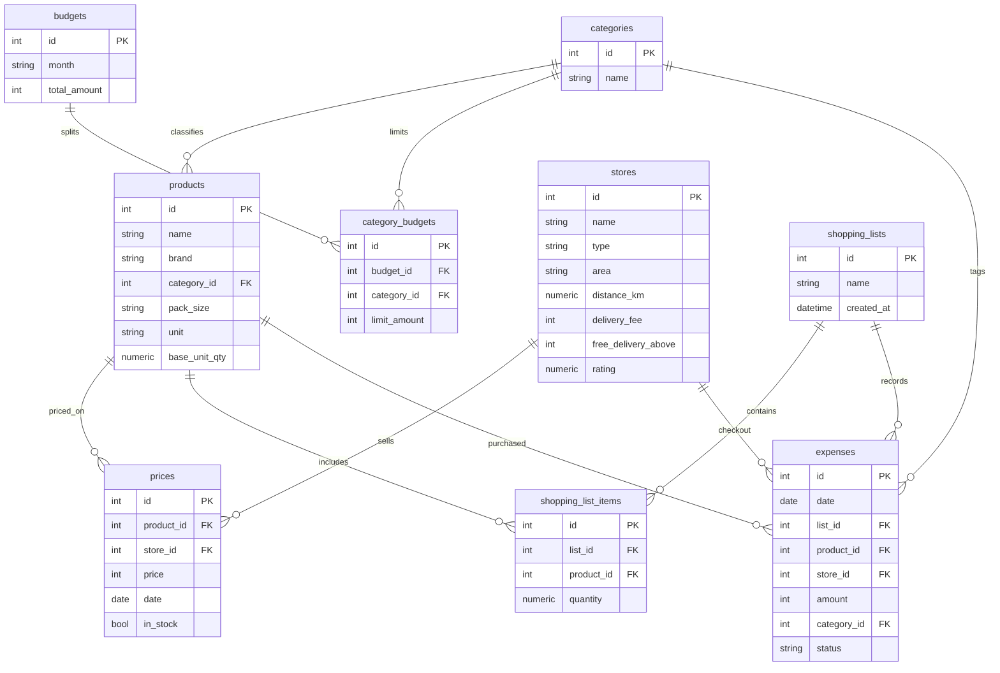

# Entity relationship

Money columns are integer paise. `prices.price`, item `quantity`, and `base_unit_qty` are constrained to be greater than zero. The current price of a product at a store is the row with the greatest `date`.
